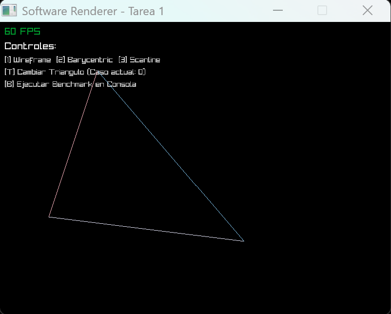
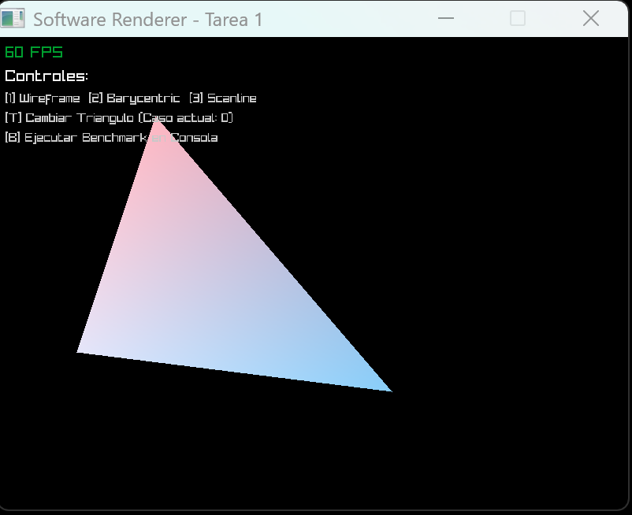
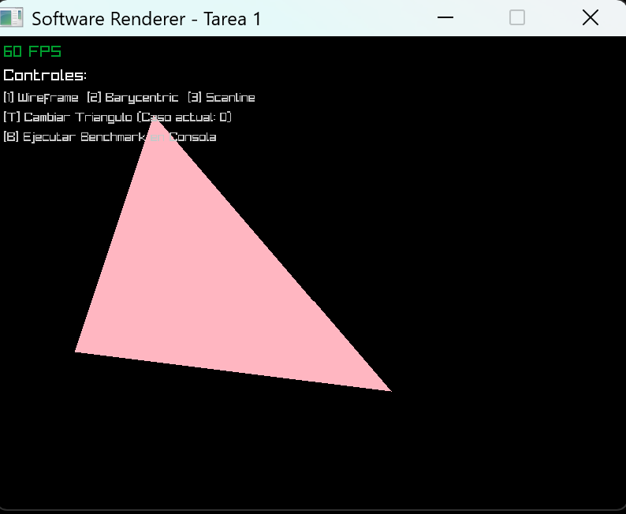

## Alejandra Avilés - 24722

# Software Graphics Pipeline: Triangle Rasterizer & Z-Buffer

Implementación de una tubería gráfica por software (Software Rasterizer) escrita en C, usando Raylib exclusivamente como una capa de abstracción para mostrar el búfer de píxeles final en una ventana de escritorio.

---

## Características del Proyecto
* **Rasterización de Triángulos**: Conversión de vértices 3D/2D a fragmentos mediante interpolación baricéntrica.
* **Interpolación de Color por Vértice**: Gradientes suaves calculados por píxel dentro del triángulo.
* **Z-Buffer (Prueba de Profundidad)**: Estructura base para garantizar el orden correcto de renderizado por profundidad.
* **Pipeline Independiente**: Lógica de renderizado desacoplada del motor gráfico general (`renderer.c` / `renderer.h`).

---

## Requisitos y Entorno
* **Entorno de desarrollo**: Windows con `w64devkit` (MinGW-w64 / GCC).
* **Librería multimedia**: Raylib (compilada localmente desde código fuente para garantizar compatibilidad binaria).

---

## Compilación y Ejecución Manual

Si estás compilando manualmente en un entorno MinGW / w64devkit, puedes compilar la librería de Raylib y el proyecto con los siguientes comandos en PowerShell:

1. **Compilar Raylib desde la fuente:**
   ```powershell
   cd raylib_src\src
   & "C:/w64devkit/bin/make.exe" PLATFORM=PLATFORM_DESKTOP CC="C:/w64devkit/bin/gcc.exe" AR="C:/w64devkit/bin/ar.exe"
   cd ..\..
   ```

2. Compilar el proyecto principal:
   ```powershell
    & "C:/w64devkit/bin/gcc.exe" main.c renderer.c -I"raylib_src/src" -o renderer.exe "raylib_src/src/libraylib.a" -lopengl32 -lgdi32 -lwinmm -lws2_32 -lole32 -lshell32
    ```

3. Ejecutar el programa:
   ```powershell
    .\renderer.exe
    ```

## Estructura del Proyecto

```powershell
filling-triangles/
│
├── .vscode/     # Configuración de tareas y depuración
├── assets/  # Imagen rasterizada 
├── raylib_src/  # Código fuente y compilación local de Raylib
├── main.c       # Punto de entrada y bucle principal de la aplicación
├── renderer.c   # Lógica del rasterizador de triángulos y búfer
├── renderer.h   # Definiciones de estructuras y prototipos
└── README.md    # Documentación del proyecto
```

## Modos de Rasterización
1. **Wireframe**: Solo dibuja los contornos del triángulo mediante líneas.


2. **FilledBarycentric**: Relleno mediante coordenadas baricéntricas evaluando el centro de cada píxel $(x + 0.5, y + 0.5)$.


3. **FilledScanline**: Relleno optimizado por barrido de líneas horizontales de arriba hacia abajo.


## Resultados de Rendimiento (Benchmark)

Se ejecutaron 100 iteraciones de rasterización para medir el tiempo de procesamiento en las modalidades:

* **Barycentric (100 iteraciones)**: 0.158000 s
* **Scanline (100 iteraciones)**: 0.021000 s

* **Observaciones**: El algoritmo de líneas horizontales reduce las comprobaciones por píxel al saltar directamente entre los extremos izquierdo y derecho de cada fila, optimizando el tiempo de procesamiento frente al recorrido total de la caja delimitadora (*bounding box*).